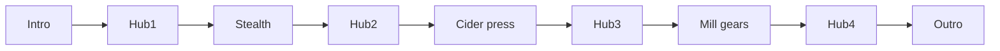
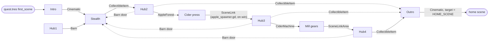

# Cider Quest scene flow

Cider Quest lives in `scenes/quests/story_quests/apple_festival/`. This page
records how its scenes are wired together today (read from the `next_scene`
values in each `.tscn`) and how the GDD says they should be wired, so the team
can close the gaps.

Folder and main-scene names under `apple_festival/` are **soft-frozen**: tester
hash links, the README level list and this file use them. Rename only in the
Godot FileSystem dock, in a separate `rename: …` PR that also updates this file
and the README (see `BRIC-PLAN.md` §6). Anything *inside* a level folder,
including `next_scene` wiring, is free to change.

## Scenes

| Folder | Main scene | uid |
|---|---|---|
| `0_intro` | `apple_festival_intro.tscn` | `uid://dvarobw3n3ptx` |
| `1_hub_1` | `hub_1.tscn` | `uid://c34ekk2t8q0r3` |
| `2_stealth` | `apple_festival_stealth.tscn` | `uid://o02oju8d2ins` |
| `3_hub_2` | `hub_2.tscn` | `uid://bi08xb2kddcdy` |
| `4_cider_press` | `apple_festival_cider_press.tscn` | `uid://dpjllk6mj5wv0` |
| `5_hub_3` | `hub_3.tscn` | `uid://ccmma82hvwug4` |
| `6_mill_gears` | `mill_gears.tscn` | `uid://cagcg8dpqjcvn` |
| `7_hub_4` | `hub_4.tscn` | `uid://bx8xnpqin2ypb` |
| `8_outro` | `apple_festival_outro.tscn` | `uid://by3f3nwlt2j5i` |

`apple_festival_basic_scene.tscn` (`uid://c7gw5g65ffcty`) is the blank
StoryQuest template scene. Nothing links to it any more.

## Intended flow (GDD)

## Actual flow (as of `feat/cabinet-profile-ci`)

Solid arrows follow the intended order; dotted arrows are extra exits.

| From | Node | `next_scene` → |
|---|---|---|
| `quest.tres` | `first_scene` | `0_intro` (fixed here; was `apple_festival_basic_scene.tscn`) |
| `0_intro` | `Cinematic` | `2_stealth` |
| `1_hub_1` | `OnTheGround/Barn/SceneLinkArea/SceneLink` | `2_stealth` |
| `2_stealth` | `OnTheGround/CollectibleItem` | `3_hub_2` |
| `3_hub_2` | `OnTheGround/AppleForest/SceneLinkArea/SceneLink` | `4_cider_press` |
| `3_hub_2` | `OnTheGround/Barn/DoorArea/SceneLink` | `2_stealth` |
| `3_hub_2` | `OnTheGround/CollectibleItem` | `8_outro` |
| `4_cider_press` | `SceneLink` (called by `apple_spawner.gd`) | `5_hub_3` |
| `5_hub_3` | `OnTheGround/CiderMachine/SceneLinkArea/SceneLink` | `6_mill_gears` |
| `5_hub_3` | `OnTheGround/Barn/DoorArea/SceneLink` | `2_stealth` |
| `5_hub_3` | `OnTheGround/CollectibleItem` | `8_outro` |
| `6_mill_gears` | `SceneLinkArea/SceneLink` | `7_hub_4` |
| `7_hub_4` | `OnTheGround/Barn/DoorArea/SceneLink` | `2_stealth` |
| `7_hub_4` | `OnTheGround/CollectibleItem` | `8_outro` |
| `8_outro` | `Cinematic` (`target = HOME_SCENE`) | Fray's End in Threadbare builds; the title screen in Cider builds (`bric_cider` feature) |

No link sets `spawn_point_path`, so the player always starts at each scene's
default position.

## Gaps for the team

These are content decisions, so they're not changed in this branch:

1. **Hub 1 is unreachable.** The intro goes straight to stealth. To match the
   GDD, point `0_intro` → `Cinematic.next_scene` at `1_hub_1/hub_1.tscn`.
   (Hub 1's barn already leads to stealth.)
2. **Hub 2/3/4 barn doors lead back to stealth.** These look copied from hub 1.
   Decide whether each barn should be a dead end, a side room, or removed.
3. **Hub 2 and hub 3 have a `CollectibleItem` that jumps to the outro**,
   skipping the remaining levels. Hub 4's is the only one the GDD calls for.
   Remove the extra ones, or change their `next_scene`.
4. **`5_hub_3`'s components folder is named `hub_1_components`.** You can
   rename it freely, since it's inside a level folder.
5. **The quest ends at `HOME_SCENE`.** In the Cider cabinet build this is
   overridden to the title screen. If the team wants a credits or "thanks for
   playing" screen first, add it as a scene after the outro.
6. `apple_festival_basic_scene.tscn` is unused. Delete it or keep it as a
   scratch scene.
7. **The intro and stealth dialogue is still the StoryQuest template text**
   ("In the Godot FileSystem, find the intro folder…", "remove or replace this
   text!").
8. **Hubs 2, 3 and 4 use tree textures from another team's quest**
   (`story_quests/shjourney/…/Tree.png`, `Tree_15.png`). Because of this the
   Cider build can't exclude `shjourney`, which adds about 16.5 MB to the
   download. Copy those two images (with their `.license` files) into
   `apple_festival/shared/props/` and repoint the hubs in the editor. Then
   add `scenes/quests/story_quests/shjourney/*` to the exclude filter of the
   "Web (Cider)" and "Windows (Cider)" export presets.
9. **The title screen still shows the Threadbare logo**, and the on-screen
   input hints show Xbox buttons (Menu/LB/RB). A Cider Quest logo and
   cabinet-style A/B/C hints are art tasks.

<!--
SPDX-FileCopyrightText: The Threadbare Authors
SPDX-License-Identifier: CC0-1.0
-->
